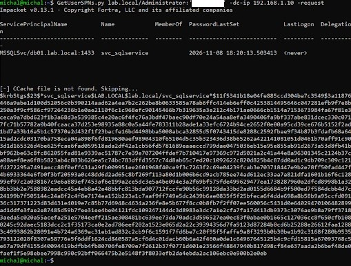
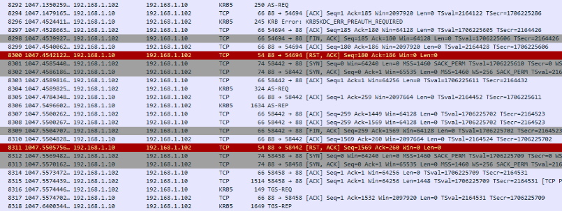
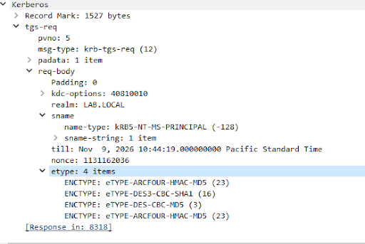
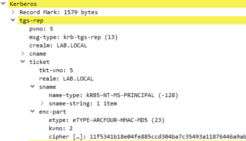
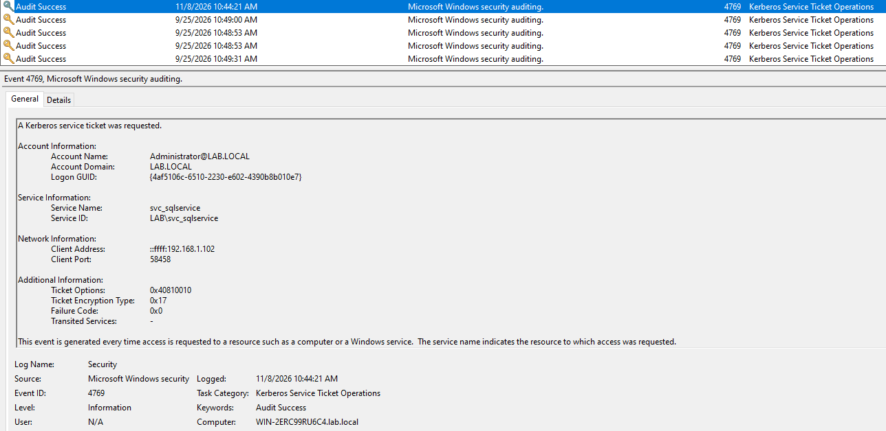
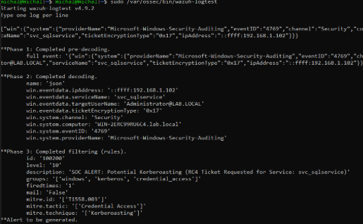

# DFIR Incident Response Report: SIM-03
## Adversary Emulation & Triage: Kerberoasting Service Account Abuse via RC4 Downgrade

---

### Executive Metadata

| Case Attribute | Technical Assignment |
| :--- | :--- |
| **Incident Tracking ID** | `IR-2026-SIM03` |
| **Classification** | Credential Access / Stealthy Offline Ticket Cracking |
| **Severity Matrix** | **HIGH (Severity Level 10 / Wazuh SIEM • Event ID 4769)** |
| **Triage Framework** | SANS / NIST SP 800-61 Rev. 2 (PICERL Workflow) |
| **Target Host Asset** | `WinServer-AD` (Domain Controller / `lab.local` / 192.168.1.10) |
| **Target Service Identity** | `svc_sqlservice` (`MSSQLSvc/db01.lab.local:1433`) |
| **Adversary Node** | `192.168.1.102` (Linux Analysis Engine / `impacket-GetUserSPNs`) |
| **Resolution Status** | **Contained • Evidence Preserved • Detection Hardened** |

---

## 1. Executive Summary & Attack Hypothesis

During scheduled active defense validation, the SOC telemetry pipeline flagged an anomalous Kerberos Ticket Granting Service (TGS) ticket request originating from internal Linux host `192.168.1.102` directed toward Active Directory Domain Controller `192.168.1.10`. 

Unlike standard workstation authentication routines, the requesting entity extracted a service ticket for domain identity `svc_sqlservice` (`MSSQLSvc/db01.lab.local:1433`) while deliberately suppressing AES cryptographic suites in favor of legacy **RC4-HMAC-MD5 (`0x17` / `23`)**.

This behavioral pattern aligns with **Kerberoasting (`MITRE ATT&CK T1558.003`)**. By obtaining a TGS ticket encrypted with the password hash of a user-based service account, adversaries can export ticket hashes to offline cracking environments (e.g., Hashcat / John the Ripper) without generating failed logon events (`Event ID 4625`) or triggering threshold-based account lockouts on the domain controller.

### Primary Investigation Objectives:
1. Dissect L7 Kerberos ASN.1 structures across `TGS-REQ` and `TGS-REP` frames to verify cipher negotiation downgrade.
2. Cross-correlate transport wire captures with host-level Windows Security telemetry (`Event ID 4769`).
3. Attribute client socket sessions to adversary tooling parameters (`GetUserSPNs.py`).
4. Engineer multi-tier detection signatures across Wazuh XML, Sigma, and Azure Sentinel / MDE KQL.
5. Formulate remediation playbooks focusing on Group Managed Service Accounts (gMSA) and encryption type enforcement.

---

## 2. Threat Actor Profile & MITRE ATT&CK Matrix

| ATT&CK Tactic | Technique ID | Technique Name | Applied Detection Mechanism |
| :--- | :--- | :--- | :--- |
| **Discovery** | `T1087.002` | Account Discovery: Domain Account | LDAP SPN queries (`GetUserSPNs`) |
| **Credential Access** | `T1558.003` | Steal or Forge Kerberos Tickets: Kerberoasting | Windows Event ID 4769 (`etype 0x17`) |
| **Defense Evasion** | `T1562.001` | Impair Defenses: Disable/Downgrade Encryption | Client cipher preference negotiation (`etype` RC4) |

---
## 3. Evidence Artifacts & Technical Reconstruction

### 3.1 Adversary Execution & Hash Export (Impacket CLI)
The intrusion commenced from internal analysis node `192.168.1.102`. The adversary executed the `GetUserSPNs.py` script from the Impacket framework, directly targeting Active Directory Domain Controller `192.168.1.10` (`WIN-2ERC99RU6C4.lab.local`):



Target Account Details:
- Target SPN: `MSSQLSvc/db01.lab.local:1433`
- Service Account Name: `svc_sqlservice`
- Password Last Set: `2026-11-08 18:20:13.503413`

Extracted Ticket Hash (Hashcat Mode 13100 Format):
- Format signature: `$krb5tgs$23$*svc_sqlservice$LAB.LOCAL$lab.local/svc_sqlservice*11f5341b18e04fe885ccd304ba7c3549$3a11876446a...`
- Cipher suite flag: `$23$` denotes RC4-HMAC-MD5 (`etype 0x17`).
- Checksum payload: `11f5341b18e04fe885ccd304ba7c3549` represents the 16-byte HMAC-MD5 validation token used for offline password verification.

Technical Breakdown:
- LDAP & Domain Reconnaissance: The tooling authenticated against the domain using legitimate domain credentials and issued an LDAP query filtering for accounts with a populated `servicePrincipalName` attribute (`(&(servicePrincipalName=*)(!(sAMAccountType=805306369)))`). Machine accounts ending with `$` were excluded to isolate user-backed service accounts, directly identifying `svc_sqlservice`.
- Lack of Password Rotation: Active Directory metadata revealed `PasswordLastSet: 2026-11-08`, confirming an active account without periodic password rotation, which increases vulnerability to dictionary-based cracking.
- Ticket Formatting for Cracking Engines: The extracted hash was formatted directly for Hashcat mode 13100 (`krb5tgs`). The structure embeds the Kerberos realm (`LAB.LOCAL`), account name (`svc_sqlservice`), ticket checksum, and the encrypted service ticket blob (`enc-part`).
- Offline Cracking Viability: Because the ticket is encrypted with a key derived directly from the password of `svc_sqlservice`, the adversary can execute offline brute-force and dictionary attacks without interacting with the network or triggering detection mechanisms on the target system.
- Stealth Characteristics & Evasion: The extraction relied entirely on valid Kerberos protocol requests. Because the KDC treats ticket requests from authenticated domain users as authorized operations, zero failed logons (`Event ID 4625`) occurred. The domain controller account lockout threshold (`Event ID 4740`) was never triggered, allowing completely stealthy credential harvesting.

---

### 3.2 Network Layer Deep Packet Inspection (Wireshark)
Network traffic was monitored on Domain Controller TCP/UDP port 88 using the display filter `kerberos || tcp.port == 88`:



Phase 1: Pre-Authentication & TGT Retrieval (Frames 8289–8306):
- Frame 8292 (`AS-REQ`): The attacker client initiated an authentication request to the KDC without pre-authentication metadata.
- Frame 8296 (`KRB Error: KRB5KDC_ERR_PREAUTH_REQUIRED`): The Domain Controller responded with error code 25, requiring an encrypted timestamp to validate identity.
- Frame 8304 (`AS-REQ`): The client resent the request including encrypted timestamp credentials within the `PA-ENC-TIMESTAMP` pre-authentication data structure.
- Frame 8306 (`AS-REP`): The KDC validated the credentials and issued a valid Ticket Granting Ticket (TGT) along with session keys for `Administrator@LAB.LOCAL`.

Phase 2: Transport Session Teardown & Reconstruction (Frames 8307–8315):
- The initial TCP session used for TGT acquisition was cleanly closed using `[FIN, ACK]` flags and acknowledged via `[RST, ACK]` (Frames 8309–8311).
- The client immediately initiated a new TCP three-way handshake from ephemeral source port `58458` to destination port `88`: `192.168.1.102:58458 -> 192.168.1.10:88` (Frames 8312–8314).

Phase 3: Service Ticket Extraction (Frames 8316–8318):
- Frame 8316 (`TGS-REQ`): The client transmitted a 149-byte request presenting its TGT to request a service ticket for `MSSQLSvc/db01.lab.local:1433`.
- Frame 8318 (`TGS-REP`): The KDC processed the request and issued a 1649-byte payload containing the RC4-encrypted service ticket.

---

### 3.3 Deep ASN.1 Protocol Dissection (Cryptographic Downgrade Analysis)
Analysis of the ASN.1 structure across the captured Kerberos PDUs confirmed deliberate cipher suite manipulation:

#### A. Cipher Downgrade Request (Frame 8316 - `TGS-REQ`)


- Target Principal Identification: Under `tgs-req -> req-body -> sname`:
  - `name-type: kRB5-NT-MS-PRINCIPAL (-128)` confirms a Windows security principal lookup.
  - `sname-string: MSSQLSvc/db01.lab.local:1433` verifies the requested target is the registered database instance.
- Client Encryption Type Negotiation: Under `req-body -> etype: 4 items`:
  - Option 1: `eTYPE-ARCFOUR-HMAC-MD5 (23)`
  - Option 2: `eTYPE-DES3-CBC-SHA1 (16)`
  - Option 3: `eTYPE-DES-CBC-MD5 (3)`
  - Option 4: `eTYPE-ARCFOUR-HMAC-MD5 (23)`
- Deliberate Downgrade Indication: Modern Windows hosts include `AES-256-CTS-HMAC-SHA1-96 (18)` and `AES-128-CTS-HMAC-SHA1-96 (17)` at the top of their offered cipher suites. The client omitted all AES algorithms and prioritized `etype 23` (RC4-HMAC). This deliberate exclusion forced the KDC to fall back to legacy encryption susceptible to offline cracking.

#### B. KDC Ticket Delivery (Frame 8318 - `TGS-REP`)


- Cipher Selection Confirmation: Under `tgs-rep -> ticket -> enc-part`:
  - `etype: eTYPE-ARCFOUR-HMAC-MD5 (23)` confirms the KDC negotiated RC4 encryption due to legacy support on the user account.
  - `kvno: 2` indicates Key Version Number 2, identifying the specific password generation of `svc_sqlservice` used to encrypt the payload.
- Forensic Cryptographic Correlation:
  - Raw cipher byte stream in Wireshark: `11f5341b18e04fe885ccd304ba7c3549a11876446a9abe1d100d52056c0b390214aad62a4ea7b2c262be8b0633585a78ab6ffc414eb6eff...`
  - Extracted CLI ticket hash: `$krb5tgs$23$*svc_sqlservice$LAB.LOCAL$lab.local/svc_sqlservice*11f5341b18e04fe885ccd304ba7c3549$3a11876446a...`
- Corroboration: The initial 32 hexadecimal characters of the Wireshark `cipher` payload match the extraction output from `GetUserSPNs.py` byte-for-byte, verifying that the captured network packet directly produced the recovered cracking artifact.

---

### 3.4 Host-Level Windows Security Telemetry (Event ID 4769)
The Windows Domain Controller (`WinServer-AD`) audited the TGS request in `Security.evtx` under the `Kerberos Service Ticket Operations` subcategory:



| Telemetry Attribute | Recorded Event Value | Diagnostic Value |
| :--- | :--- | :--- |
| **Event ID** | `4769` | A Kerberos service ticket was requested |
| **Logged Timestamp** | `11/8/2026 10:44:21 AM` | Corresponds with Wireshark packet capture frame 8318 |
| **Account Name** | `Administrator@LAB.LOCAL` | Domain account presenting the TGT to request access |
| **Service Name** | `svc_sqlservice` | Target user account associated with the database SPN |
| **Service ID** | `LAB\svc_sqlservice` | Security identifier confirming a user object rather than a computer account |
| **Client Address** | `::ffff:192.168.1.102` | IPv4-mapped IPv6 address identifying the attacker node |
| **Client Port** | `58458` | Source port matching Wireshark frames 8312–8323 |
| **Ticket Options** | `0x40810010` | Kerberos flags: Forwardable, Renewable, Canonicalize |
| **Ticket Encryption Type** | **`0x17`** | **RC4-HMAC**; anomalous indicator confirming cryptographic downgrade |
| **Failure Code** | `0x0` | Transaction successfully completed by KDC without authentication errors |

Host-Side Forensic Interpretation:
Standard Kerberos tickets requested for computer accounts utilize `0x12` (AES-256). A ticket requested for a non-machine account (`svc_sqlservice`) using weak encryption (`0x17`) deviates from normal domain baselines and serves as a primary host indicator of Kerberoasting.

---

### 3.5 SIEM Log Ingestion & Detection Rule Validation (Wazuh)
Telemetry processing was validated using `wazuh-logtest` on the Wazuh manager node:



- Phase 1: Pre-decoding: Raw JSON event telemetry from `WIN-2ERC99RU6C4.lab.local` via `windows_eventchannel` was ingested without truncation.
- Phase 2: Decoding: The native JSON decoder normalized event parameters into structured fields:
  - `win.system.eventID`: `4769`
  - `win.eventdata.serviceName`: `svc_sqlservice`
  - `win.eventdata.ticketEncryptionType`: `0x17`
  - `win.eventdata.ipAddress`: `::ffff:192.168.1.102`
  - `win.eventdata.targetUserName`: `Administrator@LAB.LOCAL`
- Phase 3: Rule Evaluation & Alert Trigger:
  - Matching Rule ID: `100200`
  - Alert Level: `10` (High Severity)
  - Description: `SOC ALERT: Potential Kerberoasting (RC4 Ticket Requested for Service: svc_sqlservice)`
  - MITRE ATT&CK Classification: Credential Access -> `T1558.003` (Kerberoasting)
  - Operational Outcome: Validates that the custom Wazuh rule triggers high-severity alerts on RC4 ticket requests targeting user accounts while filtering out standard machine account traffic.
---

## 4. Multi-Layer Containment Runbooks

### Method 1: Immediate Identity Hardening & Ticket Invalidation
If an active extraction is identified, isolate the targeted account and revoke ticket-granting structures:

```powershell
# 1. Disable the compromised service account
Disable-ADAccount -Identity "svc_sqlservice"

# 2. Reset the account password twice to invalidate cached Kerberos keys
$DummyPass = ConvertTo-SecureString "C0mplexTempP@ss2026!#%" -AsPlainText -Force
Set-ADAccountPassword -Identity "svc_sqlservice" -NewPassword $DummyPass -Reset
Set-ADAccountPassword -Identity "svc_sqlservice" -NewPassword $DummyPass -Reset

# 3. Purge Active Directory Kerberos ticket cache on DC
klist purge -li 0x3e7
```

### Method 2: Host Firewall Boundary Isolation
Sever communication from the adversary workstation across Kerberos authentication boundaries:

```powershell
# Block Kerberos authentication traffic from the rogue Linux node
New-NetFirewallRule -DisplayName "SOC-ISOLATE-KERB-192.168.1.102" `
                    -Direction Inbound `
                    -Action Block `
                    -RemoteAddress "192.168.1.102" `
                    -Protocol TCP `
                    -LocalPort 88 `
                    -Profile Any
```

---

## 5. Detection Engineering & Hardening

### 5.1 Wazuh SIEM XML Detection Rule
Append to `/var/ossec/etc/rules/local_rules.xml` to detect RC4 service ticket requests targeting user accounts:

```xml
<group name="windows,kerberos,credential_access,">
  <rule id="100200" level="10">
    <if_sid>60103</if_sid>
    <field name="win.system.eventID">^4769$</field>
    <field name="win.eventdata.ticketEncryptionType">^0x17$</field>
    <match negate="yes">\$</match>
    <description>SOC ALERT: Potential Kerberoasting Attack (RC4 Ticket Requested for User Account: $(win.eventdata.serviceName))</description>
    <mitre>
      <id>T1558.003</id>
    </mitre>
  </rule>
</group>
```

### 5.2 Multi-Platform Detection Signatures

#### Universal Sigma Rule (`sigma/win_security_kerberoasting_rc4.yml`)
```yaml
title: Potential Kerberoasting Activity - RC4 Ticket Request
id: c8b31d24-8f4e-4b92-8173-9e4a0d8291b5
status: experimental
description: Detects Kerberos Service Ticket (TGS) requests utilizing weak RC4-HMAC encryption (0x17) targeting non-machine accounts.
author: DFIR Engineering Lab
references:
    - [https://attack.mitre.org/techniques/T1558/003/](https://attack.mitre.org/techniques/T1558/003/)
logsource:
    product: windows
    service: security
detection:
    selection:
        EventID: 4769
        TicketEncryptionType: '0x17'
        FailureCode: '0x0'
    filter_machine_accounts:
        ServiceName|endswith: '$'
    condition: selection and not filter_machine_accounts
falsepositives:
    - Legacy applications and services lacking AES Kerberos support.
level: high
tags:
    - attack.credential_access
    - attack.t1558.003
```

#### Azure Sentinel / Microsoft Defender for Endpoint (KQL)
```kql
// Query: Kerberoasting-Weak-Encryption-Triage
SecurityEvent
| where EventID == 4769
| extend TicketEncryptionType = tostring(EventData.TicketEncryptionType),
         ServiceName = tostring(EventData.ServiceName),
         TargetUserName = tostring(EventData.TargetUserName)
| where TicketEncryptionType == "0x17"
| where not(ServiceName endswith "$") and ServiceName != "krbtgt"
| summarize 
    TicketRequestCount = count(), 
    RequestedServices = make_set(ServiceName), 
    StartTime = min(TimeGenerated), 
    EndTime = max(TimeGenerated) 
    by TargetUserName, IpAddress, bin(TimeGenerated, 5m)
| where TicketRequestCount >= 1
| project StartTime, EndTime, IpAddress, TargetUserName, TicketRequestCount, RequestedServices
```

---

## 6. Lessons Learned & Action Items

1. **Migration to Group Managed Service Accounts (gMSA):**  
   Standard user accounts configured with SPNs represent high-risk identities. Active Directory environments should transition services to **Group Managed Service Accounts (gMSA)**. gMSA accounts utilize 128-character, cryptographically randomized passwords automatically rotated by Active Directory, rendering offline brute-force cracking mathematically infeasible.
2. **Enforce AES Encryption on Service Accounts:**  
   Disable RC4 fallback across all service identities by configuring the `msDS-SupportedEncryptionTypes` Active Directory attribute to support **AES128-CTS-HMAC-SHA1-96** and **AES256-CTS-HMAC-SHA1-96** (`0x18` or `0x8`).
3. **Honeytokens & Decoy SPNs (Active Defense):**  
   Deploy decoy user accounts with attractive SPN strings (e.g., `MSSQLSvc/core-finance.lab.local:1433`) and assign arbitrarily long passwords. Because legitimate systems will never request tickets for this decoy identity, any `Event ID 4769` referencing this account serves as a high-fidelity, zero-false-positive indicator of active domain reconnaissance.
4. **Audit Policy Verification:**  
   Standard default GPOs frequently do not log `Event ID 4769`. Enterprise baselines must explicitly enforce `Audit Kerberos Service Ticket Operations -> Success and Failure` across Domain Controller OU tiers.
